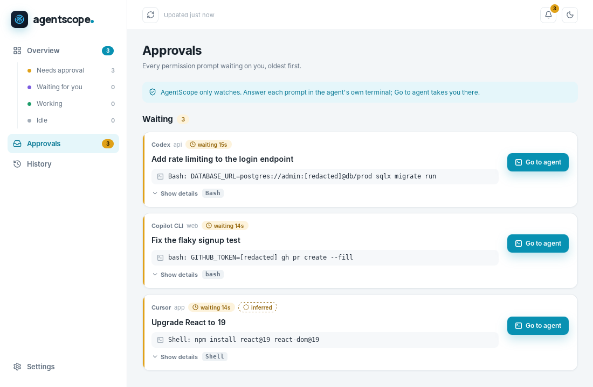

# AgentScope

Every agent. Every action. One view.

AgentScope is a free, open source desktop app for macOS, Windows and Linux. It shows every AI coding agent running on your machine (Claude Code, Codex CLI, GitHub Copilot CLI and Cursor), their subagents, what each one is doing right now, and which ones are waiting for your approval. When one needs you, a notification and **Go to agent** take you straight to its terminal or editor.



- **Observe by default.** AgentScope never answers prompts or changes what an agent does unless you turn on answering for a harness. Its hooks fail open, so even a broken install cannot block an agent.
- **Local only.** Everything is read and stored on your machine. The only network calls are the update check against GitHub Releases, which you can turn off, and phone push if you turn it on.
- **Reversible.** Connecting a harness shows the exact config diff first, backs up the original, and Disconnect removes only what was added.

## Install

Download the installer for your system from the [latest release](https://github.com/Iruora/AgentScope/releases/latest).

| System | File |
|---|---|
| macOS (Apple silicon) | `AgentScope_<version>_aarch64.dmg` (or `.app.zip`) |
| macOS (Intel) | `AgentScope_<version>_x64.dmg` (or `.app.zip`) |
| Windows | `AgentScope_<version>_x64-setup.exe` (or the `.msi`), or `_x64_portable.zip` to run without installing |
| Linux | `.AppImage`, `.deb` (Debian, Ubuntu) or `.rpm` (Fedora) |

The builds are not code signed yet, so macOS and Windows ask you to confirm once before the first launch:

- **macOS:** open the `.dmg` and drag AgentScope to Applications, then open it. When macOS says it cannot verify the app, click **Done**, open **System Settings → Privacy & Security**, scroll down and click **Open Anyway** next to AgentScope, then confirm. From the terminal, `xattr -dr com.apple.quarantine /Applications/AgentScope.app` does the same.
- **Windows:** when SmartScreen shows "Windows protected your PC", click **More info**, then **Run anyway**.
- **Linux:** for the AppImage, run `chmod +x AgentScope_*.AppImage` and start it. For the `.deb`, run `sudo apt install ./AgentScope_*.deb`.

Package managers, once they are set up for a release (see [docs/packages.md](docs/packages.md)):

```sh
brew install --cask iruora/agentscope/agentscope                                  # macOS
winget install Iruora.AgentScope                                                  # Windows
scoop bucket add agentscope https://github.com/Iruora/scoop-agentscope && scoop install agentscope
yay -S agentscope-bin                                                             # Arch Linux
```

From version 1.1.0, AgentScope updates itself: when a new release is out it shows **Update and restart** in the sidebar and in Settings. Updates are signed, and the app checks the signature before installing. The portable Windows zip does not update in place; it links to the download page instead.

## Getting started

On first launch AgentScope lists the harnesses it found and lets you connect each one. Connecting adds observe-only hooks after showing you the diff, which is what makes approval prompts show up the moment they appear. Without hooks, AgentScope still follows transcripts and running processes. You can connect or disconnect any harness later in **Settings → Integrations**.

| Harness | Hook config | Also reads |
|---|---|---|
| Claude Code | `~/.claude/settings.json` | transcripts, `~/.claude/sessions` |
| Codex | `~/.codex/hooks.json` (trust it once with `/hooks` in Codex) | rollouts in `~/.codex/sessions` |
| Copilot CLI | its own file, `~/.copilot/hooks/agentscope.json` | `events.jsonl` and lock files in `~/.copilot/session-state` |
| Cursor | `~/.cursor/hooks.json` | hooks only; approvals are inferred and marked *inferred* |

### Answering approvals (Claude Code)

Turn on **Answer approvals from AgentScope** for Claude Code in **Settings → Integrations** to approve or deny its permission prompts from the Approvals inbox, the tray menu, or a small popup that appears in the corner of the screen without taking focus. A prompt waits in AgentScope for the time you choose (60 seconds by default); if you don't answer, press **Ask in terminal**, or AgentScope is closed, Claude Code asks in the terminal as usual. Commands that look risky, like `rm -rf`, a force push or a piped install, take a second click unless you turn that off.

### Phone push

**Settings → Phone push** sends the same alerts to your phone through ntfy, Pushover, a Discord or Slack webhook, or a Telegram bot. It is off by default, and unless you include names and commands, the message only says that an agent needs you.

### Keeping track

- **Usage** estimates what each day, harness, repo and model cost at API list prices, from the token counts the harnesses report. The prices ship with the app; put a `prices.json` in the data folder to override them. On a subscription plan this is what the same work would cost through the API, not what you pay.
- **Alerts** on session cards flag a tool running for 10 minutes or more, the same call failing 3 times in a row, a session quiet for 15 minutes, and two live sessions editing the same file. Desktop notifications for them are off by default (**Settings → Notifications**).
- **Files** on a session page lists the files the agent wrote, with a read-only `git diff` of each.
- **Labels** let you pin, rename, tag and annotate a session from its page. Pinned sessions never expire, and tags become filters on Overview and History.
- **Export** saves a session as Markdown (to read or paste into a PR) or JSON, with keys and tokens redacted.
- **Mini widget**: a small always-on-top window listing who needs you and every live agent. Toggle it from the tray menu or **Settings → Quick access**.

Ended sessions stay in **History** for 7 days by default; change it in **Settings → History**. Daily usage totals are kept for 90 days.

To uninstall, disconnect each harness in Settings first, then delete the app. If you skip that, the leftover hooks simply do nothing.

## Documentation

- Website: [iruora.github.io/AgentScope](https://iruora.github.io/AgentScope/) (source in `site/`)

- [v1 spec](docs/SPEC.md)
- [Harness research](docs/research/harnesses.md)
- Adapter notes: [Claude Code](docs/adapters/claude-code.md), [Codex](docs/adapters/codex.md),
  [Copilot CLI](docs/adapters/copilot-cli.md), [Cursor](docs/adapters/cursor.md)

## Repository layout

```
apps/desktop/        Tauri app: src-tauri/ (Rust shell, tray, IPC) and src/ (React UI)
crates/core/         data model, reducer, SQLite store, local ingest server (no Tauri deps)
crates/adapters/     one module per harness
crates/hook/         `agentscope-hook`, the fail-open shim harness hooks call
crates/protocol/     wire format shared by the shim and the app (kept tiny for the shim)
fixtures/            recorded hook payloads and transcript samples per harness
docs/                spec and research
```

## Development

Prerequisites: Rust (stable), Node 22, pnpm 10, and the
[Tauri system dependencies](https://v2.tauri.app/start/prerequisites/) for your OS.

```sh
cd apps/desktop
pnpm install
pnpm tauri dev          # run the app with hot reload
pnpm tauri build        # build installers into target/release/bundle
```

Both Tauri commands first run `pnpm sidecar`, which builds `agentscope-hook`
and copies it to `src-tauri/binaries/` where Tauri bundles it next to the app.
Plain `cargo` builds use an empty placeholder there instead, and the app then
reports the shim as missing.

From the repo root:

```sh
cargo test --workspace  # all Rust tests; also regenerates apps/desktop/src/bindings.ts
cargo build --release -p agentscope-hook
```

Set `AGENTSCOPE_DATA_DIR` to run the app and the shim against a scratch data
directory instead of your real one. `CLAUDE_CONFIG_DIR`, `CODEX_HOME`, and
`COPILOT_HOME` point those adapters at scratch configs, as they do for the
harnesses themselves. To send a test event by hand while the app
is running:

```sh
echo '{"session_id":"demo"}' | target/release/agentscope-hook --harness claude-code --event SessionStart
```

## Releasing

1. Set the new version in `apps/desktop/src-tauri/tauri.conf.json`,
   `apps/desktop/package.json` and the root `Cargo.toml`, and merge that.
2. Tag the merge commit and push the tag: `git tag v1.0.0 && git push origin v1.0.0`.
   Without a terminal, run the Release workflow from the Actions tab on `main`
   with the tag name instead; it creates the tag for you. Tick **publish** to
   have it publish the release once every download is attached.
3. The [Release workflow](.github/workflows/release.yml) builds the installers
   for every platform, attaches them to a draft release with a `latest.json` for
   the in-app updater, and (with **publish**) publishes it. Installed apps pick
   up the new version once the release is published.
4. After publishing, the [Packages workflow](.github/workflows/packages.yml)
   updates Homebrew, Scoop, winget and the AUR, each only once its secret is
   set up ([docs/packages.md](docs/packages.md)).

The updater files are signed with a key kept in two repository secrets,
`TAURI_SIGNING_PRIVATE_KEY` and `TAURI_SIGNING_PRIVATE_KEY_PASSWORD`. The
matching public key is `plugins.updater.pubkey` in `tauri.conf.json`. Keep the
private key safe: without it, installed apps cannot be updated anymore. To make
a new pair, run `pnpm tauri signer generate`, replace the public key, and
update both secrets; apps with the old key then need one manual install.

## License

Licensed under either of [Apache License, Version 2.0](LICENSE-APACHE) or
[MIT license](LICENSE-MIT) at your option. Unless you explicitly state
otherwise, any contribution you submit for inclusion in this project, as
defined in the Apache-2.0 license, is dual licensed as above, without any
additional terms or conditions.
